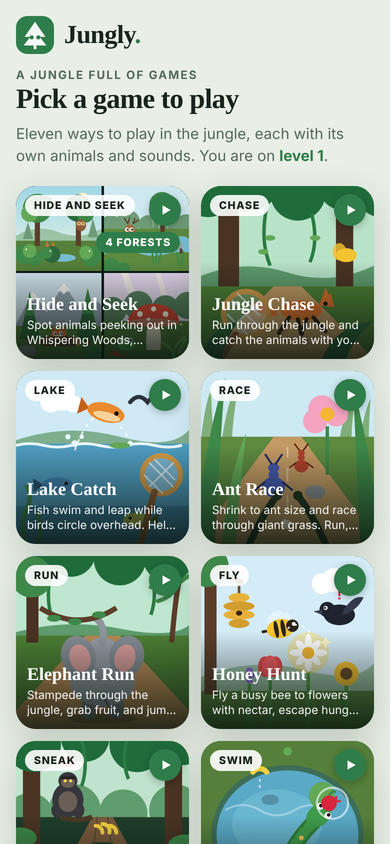
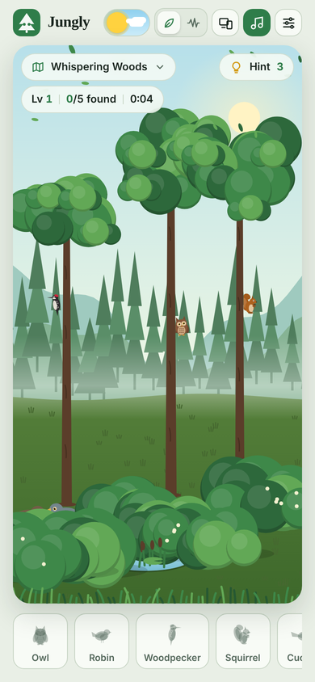
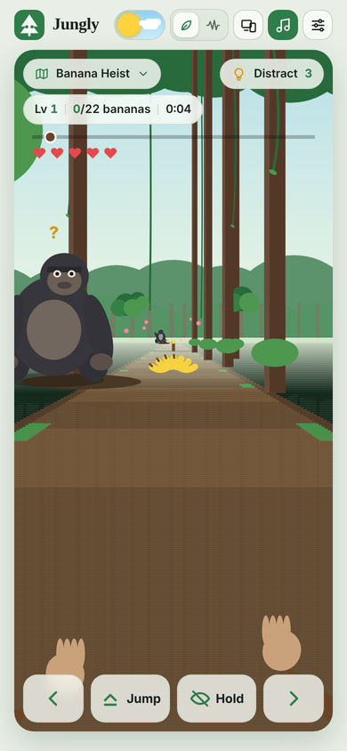
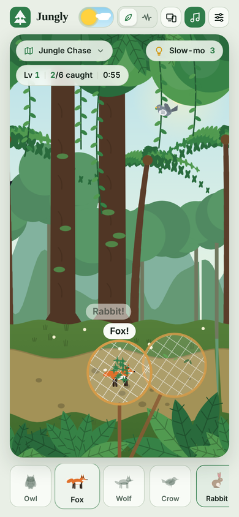
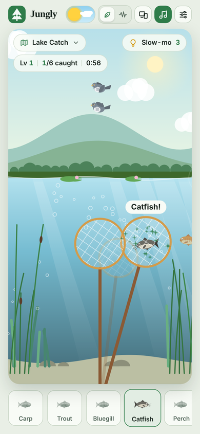
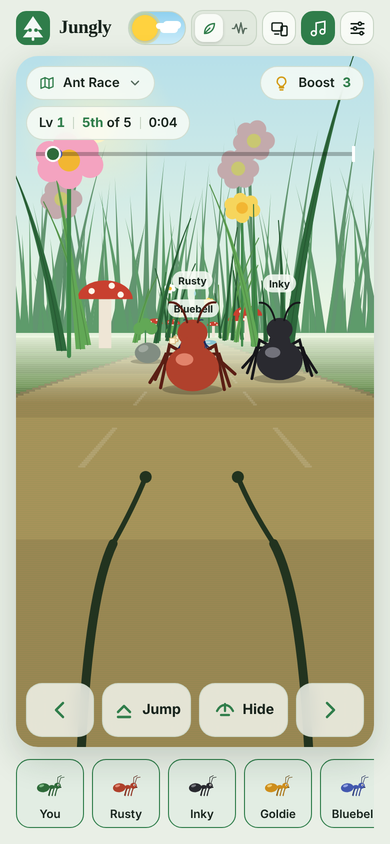
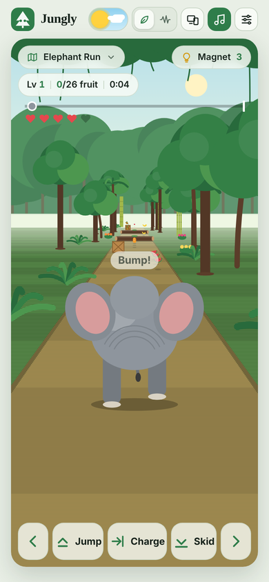
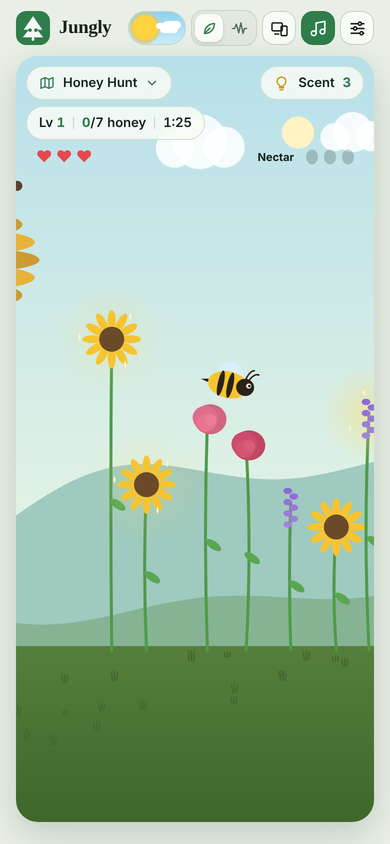
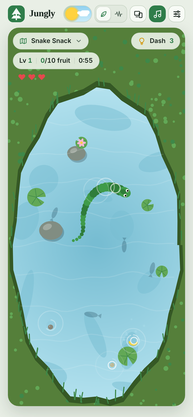

# Jungly

**A jungle full of games.** Eleven animated, sound-filled mini games in one installable web app: spot animals peeking out of the forest, catch runners with a net, sneak bananas past gorillas, fly a honey bee, and more.

Everything is drawn live on a canvas and every animal call and piece of music is synthesized in the browser, so the whole app is a single HTML file with no build step, no framework and no audio downloads.

<p align="center">
  
  
  
</p>

## Games

| Game | Type | How to play |
| --- | --- | --- |
| **Hide and Seek** (4 forests: Whispering Woods, Riverbank, Pine Ridge, Mushroom Glade) | Spot | Animals peek out of leaves, rocks, logs and reeds, then duck back down. Tap them while you can see them. |
| **Jungle Chase** | Chase | The jungle scrolls past as animals run, hop and fly by. Tap ahead of a runner to throw your net. |
| **Lake Catch** | Lake | Fish swim and leap out of the water. Dip your net, and tap diving birds to shoo them off your fish. |
| **Ant Race** | Race | First-person ant racing through giant grass. Change lanes, jump pebbles and twigs, hide under a leaf from birds and rain. |
| **Elephant Run** | Run | Third-person stampede. Collect fruit, jump logs, skid under branches and head-charge through crates. |
| **Honey Hunt** | Fly | Drag to fly a bee to sparkling flowers, carry the nectar to the hive and escape the birds. |
| **Banana Heist** | Sneak | First-person monkey in the treetops. Grab bananas while the gorillas look away and hold still when they watch. |
| **Snake Snack** | Swim | Top-down pond. Steer a water snake to catch falling fruit before it sinks, without biting your tail. |

<p align="center">
  
  
  
  
</p>
<p align="center">
  
  
</p>

## Features

- **Installable PWA** that works offline after the first visit (manifest, icons and a service worker).
- **Day and night** switch with stars, moon and fireflies, plus Auto to follow the device setting.
- **Five colour skins**: Pine, Autumn, Sakura, Frost and Mystic.
- **Natural or electronic sounds**: every animal call is generated live and randomised on each tap; generative background music.
- **Screen layouts**: Auto, Mobile (one-hand phone column) or Tablet (bigger buttons and cards).
- **Levels** get harder as you go: faster animals, more camouflage, more birds and gorillas.
- **Your own recordings**: in Settings you can add CC0 audio clips for any forest animal; they are stored in the browser (IndexedDB).
- Touch, mouse and keyboard controls; respects `prefers-reduced-motion`.

## Controls

| Game | Touch | Keyboard |
| --- | --- | --- |
| Hide and Seek, Jungle Chase, Lake Catch | Tap | Mouse click |
| Ant Race | Tap sides or swipe for lanes, tap middle or swipe up to jump, swipe down to hide | Arrows or WASD, Space |
| Elephant Run | Sides for lanes, swipe up to jump, swipe down to skid, tap middle to charge | Arrows or WASD, Space, Down, Enter or C |
| Honey Hunt, Snake Snack | Drag to steer | Arrows or WASD |
| Banana Heist | Sides for lanes, tap to jump, press and hold to hide | Arrows or WASD, Space, hold Shift or Down |

The hint button changes per game: Hint, Slow-mo, Boost, Magnet, Scent, Distract or Dash.

## Run it locally

No install or build is needed. Serve the folder with any static server (service workers need `http://localhost` or HTTPS, not `file://`):

```bash
python3 -m http.server 8080
# then open http://localhost:8080
```
## App Live

**[▶ Open the live app](https://soorajacontec.github.io/jungly/)**


```bash
git remote add origin https://github.com/<your-user>/jungly.git
git branch -M main
git push -u origin main
```

## Project structure

```
index.html                 the whole app: markup, styles and game code
manifest.json              PWA manifest
sw.js                      service worker (offline cache)
icons/                     app icons (192, 512, maskable, Apple touch)
docs/screenshots/          images used in this README
.github/workflows/pages.yml  GitHub Pages deployment
```

## Sounds and fonts

All sound effects and music are synthesized with the Web Audio API at runtime, so there are no third-party audio files and no royalty fees. Typefaces (Fraunces and Figtree) load from Google Fonts with system-font fallbacks.

## License

[MIT](LICENSE)
